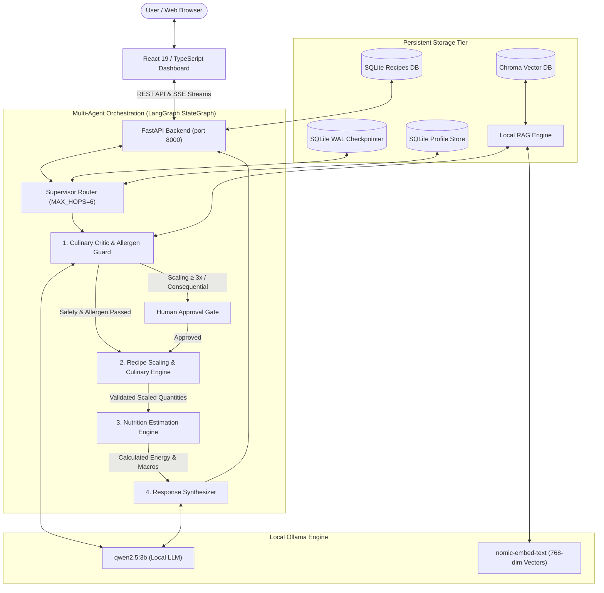

# Recipe Scaler & Nutrition Intelligence Platform — Production AI Multi-Agent System

An enterprise-grade, autonomous multi-agent AI recipe platform engineered with **LangGraph StateGraph**, local **Ollama** (`qwen2.5:3b` and `nomic-embed-text`), persistent **SQLite checkpointing & long-term memory**, local **ChromaDB RAG**, non-linear **Culinary Scaling & Allergen Engines**, **Server-Sent Events (SSE) Multi-Agent Streaming**, and an award-winning **React 19 / TypeScript** dark-first SaaS interface.

---

## 1. System Architecture



---

## 2. Key Capabilities & Features

### Frontend (React 19 + TypeScript + Tailwind CSS)
- **Dashboard / Overview**: Personalized executive dashboard with KPI metrics, quick generation templates, system health status, and recent recipes.
- **AI Recipe Studio**: Natural-language and structured recipe generator with interactive ingredient tags, step checklists, servings/time controls, copy/print, and JSON export.
- **Recipe Collection**: Full SQLite-backed recipe book with cuisine tags, favorites toggle, search, full recipe modal, and direct 1-click scaling.
- **Recipe Scaling Studio**: Interactive servings slider with fractional unit conversion (e.g. `1 1/2 cups`), non-linear culinary scaling alerts (leaveners, spices, salt), and cooking vessel guidance.
- **Nutrition Intelligence**: Macro breakdown cards (Calories, Protein, Carbs, Fat, Fiber, Sugar, Sodium), caloric split bar, per-serving vs. total yield toggle, and FDA disclaimer.
- **Agent Activity (SSE Streaming)**: Live multi-agent execution pipeline displaying real-time node state (Supervisor, Critic, Scaler, Nutrition, Synthesizer) with millisecond timings and interactive Human Approval Gate.
- **AI Memory Center**: Short-term SQLite thread inspector, long-term culinary profile manager, and persistent memory reset.
- **Knowledge Base (RAG)**: ChromaDB semantic search interface with document viewer, chunk inspections, and citations.
- **Global Search**: Modal search (`Ctrl+K`) for instant access across saved recipes and system actions.

### Backend & AI Architecture (Python 3.13 + FastAPI + LangGraph)
- **32 REST & SSE Endpoints**: Full API surface covering `/api/recipe/stream` (SSE), `/api/recipe/generate`, `/api/recipe/scale-advanced`, `/api/recipe/nutrition-analysis`, and `/api/recipes/saved` CRUD.
- **Non-Linear Culinary Scaling (`scaling_engine.py`)**: Sub-linear scaling exponent ($S^{0.65}$ to $S^{0.75}$) for leaveners, spices, and salt; equipment recommendations and thermal warnings for large batch scaling.
- **Allergen Guard (`allergy_guard.py`)**: Scans recipes for 9 major allergens (peanuts, tree nuts, dairy, gluten, eggs, soy, shellfish, fish, sesame) and suggests safe culinary substitutes.
- **Nutrition Engine (`nutrition_engine.py`)**: Heuristic macro estimation, caloric percentage distribution, and per-serving calculations.
- **Zero Hallucination RAG (`retriever.py`)**: ChromaDB vector store backed by `nomic-embed-text` with source citations and strict abstention.

---

## 3. Prerequisites (Windows)

1. **Install Ollama** from [https://ollama.com](https://ollama.com).
2. **Pull local models** (100% offline, zero API keys required):
   ```powershell
   ollama pull qwen2.5:3b
   ollama pull nomic-embed-text
   ```
3. **Install Python dependencies**:
   ```powershell
   pip install -r requirements.txt
   ```
4. **Install Frontend dependencies**:
   ```powershell
   cd frontend
   npm install
   cd ..
   ```

---

## 4. How to Run the Platform

### Option A: Full-Stack Web Application (Recommended)

Open two terminals:

#### Terminal 1 — Start FastAPI Backend:
```powershell
uvicorn api:app --reload --host 127.0.0.1 --port 8000
```
*API Swagger Documentation is available at: [http://localhost:8000/docs](http://localhost:8000/docs)*

#### Terminal 2 — Start React Web Dashboard:
```powershell
cd frontend
npm run dev
```
*Web Dashboard is available at: [http://localhost:5173](http://localhost:5173)*

---

### Option B: Interactive Terminal CLI Runner

```powershell
python main.py
```

Menu options:
1. Run TA2 Multi-Agent Autonomous Demo
2. Run TA1-vs-TA2 Evaluation Suite (5 Shared Cases)
3. Run Local RAG Demo (k=1 vs k=3 & Abstention)
4. Run Long-Term Memory Persistence & Amnesia Demo
5. Run Human Oversight & Safety Approval Demo
6. Run Tool Failure & Recovery Demo
7. Run Baseline TA1 Validation Tests
8. Ask Custom Question
9. Exit

---

## 5. Verification & Testing Commands

To run individual automated test suites:

- **Run TA1 vs TA2 Evaluation Benchmark (100% Pass Rate):**
  ```powershell
  python -m ta2.evaluation.evaluate
  ```
- **Test Safety Guardrails & Human Approval Decision Paths:**
  ```powershell
  python -m ta2.test_safety_approval
  ```
- **Test Injected Tool Failure & Defensive Recovery:**
  ```powershell
  python -m ta2.test_tool_failure
  ```
- **Test Multi-Turn Thread Continuity (SQLite Checkpointer):**
  ```powershell
  python -m ta2.test_conversation
  ```
- **Test Long-Term Memory Persistence & Amnesia Comparison:**
  ```powershell
  python -m ta2.memory.seed_memory
  ```
- **Test Local Chroma RAG:**
  ```powershell
  python -m ta2.rag.retriever
  ```
- **Build Frontend TypeScript Bundle:**
  ```powershell
  cd frontend && npm run build
  ```

---

## 6. Frozen TA1 Baseline

The original TA1 baseline is preserved and frozen in:
[`ta1/`](file:///ta1/)
